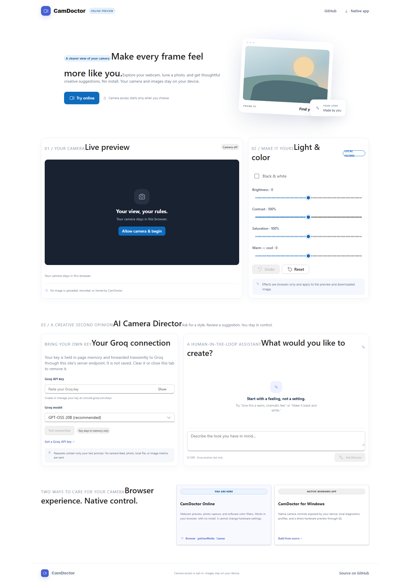
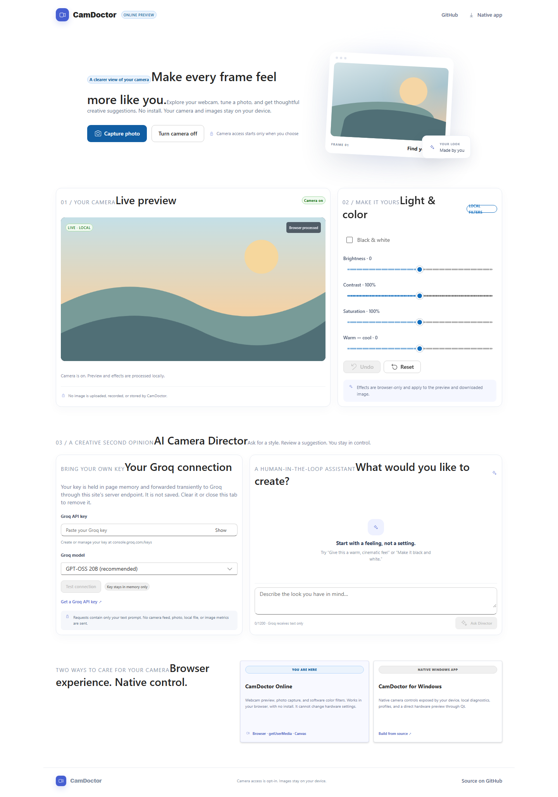
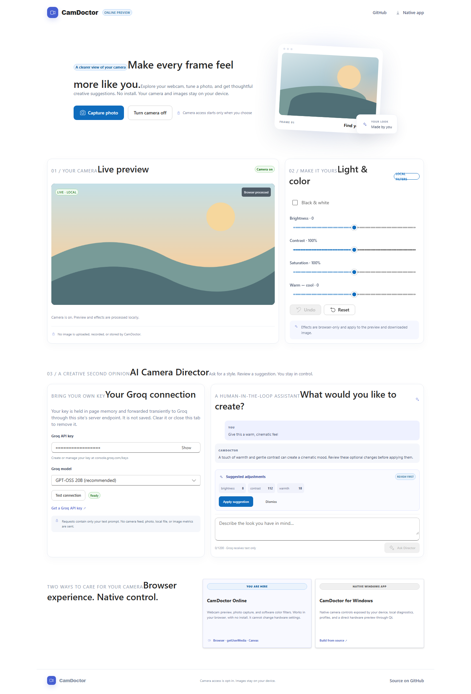

# CamDoctor

CamDoctor is a webcam diagnostics and creative-control project with two separate
experiences: a native Windows desktop application and an optional browser demo.
The native application remains the full-featured camera tool; the website uses
the browser's camera APIs and does not replace the native camera backend.

**Repository:** [chirayukapoor5/CamDoctor-with-AI-powered-enhancements](https://github.com/chirayukapoor5/CamDoctor-with-AI-powered-enhancements)

**Live browser demo:** [CamDoctor Online](https://web-eight-phi-50.vercel.app/)

## What is built

### Native Windows application

- Live camera preview and device-supported hardware controls.
- Rolling preview performance metrics: FPS, average frame interval, interval
  jitter, and late preview intervals. Preview timing does not claim hardware
  frames were dropped.
- Sampled image-quality diagnostics, including luminance, clipping, contrast,
  sharpness/edge-detail measurement, histogram, and analysis duration.
- Optional Groq AI Camera Director that proposes changes for review before
  applying them; automatic changes are opt-in.
- Deterministic local image effects, preview, Undo, and Reset.
- Groq credentials are kept in OS-protected storage. No API key belongs in
  `.env`, source code, or project settings.

The native application targets Windows; camera control availability depends on
the connected camera and its driver. Image-quality observations are measurements
and heuristics, not definitive diagnoses. Camera frames are not uploaded to Groq.

### Browser experience

The separate `web/` app is a recruiter-friendly browser demo built with React,
TypeScript, Fluent UI, Canvas, and Vite. It requests camera permission only
after the user starts the experience. It supports local photo capture and
effects, Undo/Reset, and an optional Groq Camera Director using Bring Your Own
Key (BYOK). The key is held in page memory and forwarded through same-origin
server handlers; prompts and validated tool proposals are sent to Groq, but
photos and video are not. Manual camera effects work without Groq.

Browser functionality is not equivalent to native Windows hardware controls.
See the app's privacy and platform notes before use.

## Project screenshots

These screenshots are from the browser demo. The preview uses a generated
test-camera scene, and the AI proposal is a mocked example; no real camera image,
Groq key, or user data is shown.







## Run the browser app locally

Requirements: Node.js and npm.

```powershell
cd web
npm install
npm run dev
```

Open the local URL printed by Vite. For local API-handler development, the Vite
configuration wires `/api/*` to the same handlers used by Vercel.

Run its automated checks:

```powershell
npm test
npm run test:e2e
npm run build
```

### Free web hosting

The browser app can be deployed on Vercel's free Hobby plan. Import this
repository, set the project root to `web`, and use the included Vercel
configuration so the `/api` handlers are deployed with the frontend. Add no
Groq secret to deployment settings; users bring their own key in the browser.
The current public preview is linked at the top of this README.

## Build the native application

Native desktop builds target Windows only. Requirements: Windows 10 or later,
CMake 3.24+, Visual Studio 2022 with the Desktop C++ workload, and Qt 6.5+ with
Core, Gui, Widgets, Multimedia, Concurrent, and Network.

```powershell
cmake -S . -B build -G "Visual Studio 17 2022" -A x64 `
  -DCMAKE_PREFIX_PATH="C:\path\to\Qt\6.x\msvc2022_64"
cmake --build build --config Release
ctest --test-dir build -C Release --output-on-failure
```

## Groq setup

- **Native app:** open **Settings → AI Provider → Groq**, enter your own key,
  and choose **Test Connection** or **Save & Connect**. The saved key is stored
  in OS-protected credential storage.
- **Browser app:** enter a key in the AI panel. It is not saved and is cleared
  when the page is reloaded or closed.

Create and manage keys at [Groq Console](https://console.groq.com/keys). Never
commit API keys or `.env` files.

## Privacy

- Camera permission is explicit. Preview processing and photo effects are local.
- No automatic photo capture, image upload, or photo storage.
- Groq is optional; manual controls continue to work without it.
- The browser assistant sends the prompt and requested non-image context to
  Groq. Review proposed adjustments before applying them.
- Native Groq keys are stored in the operating system credential store; browser
  BYOK keys are transient in page memory.

## Tests and verification

Latest local verification: native CTest **11/11 passed**; web unit/API tests
**9 passed**; browser end-to-end tests **4 passed**; production build succeeded;
`npm audit` reported **0 vulnerabilities**. Browser checks use mocked API
responses and a generated test camera; they do not certify every physical
webcam or mean the service is deployed. Run the commands above to verify your
local checkout.

## License and attribution

The native application is distributed under the MIT License; see [LICENSE](LICENSE)
and [NOTICE.md](NOTICE.md) for license and prior-art details. Keep these notices
with source distributions.
